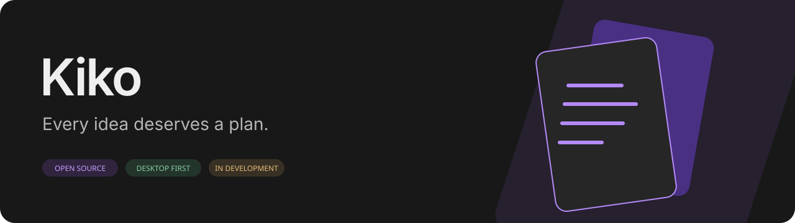
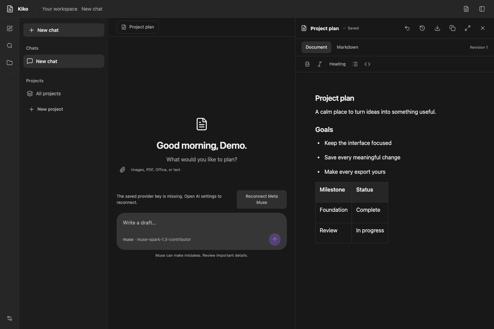
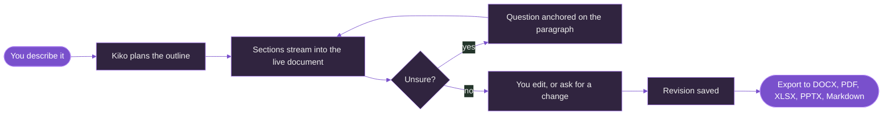
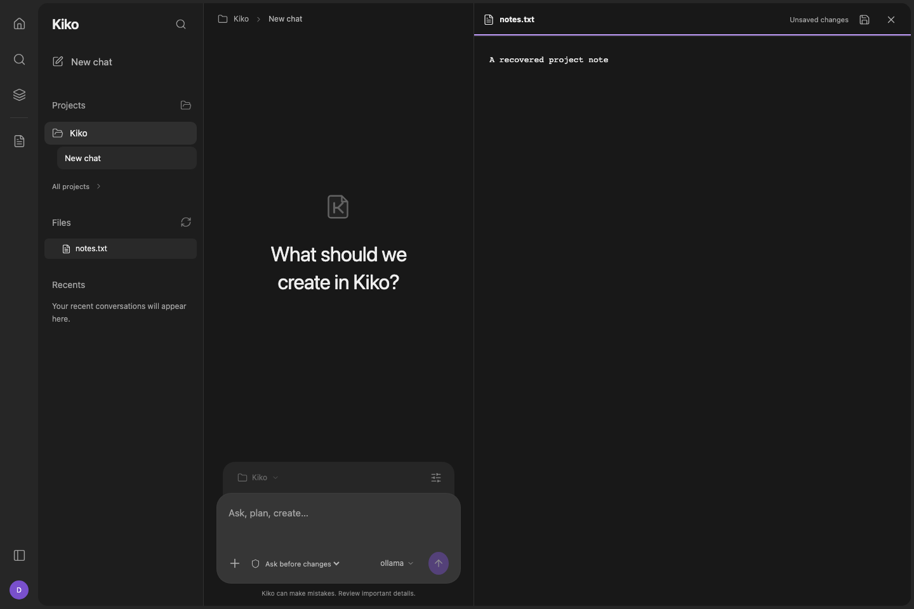
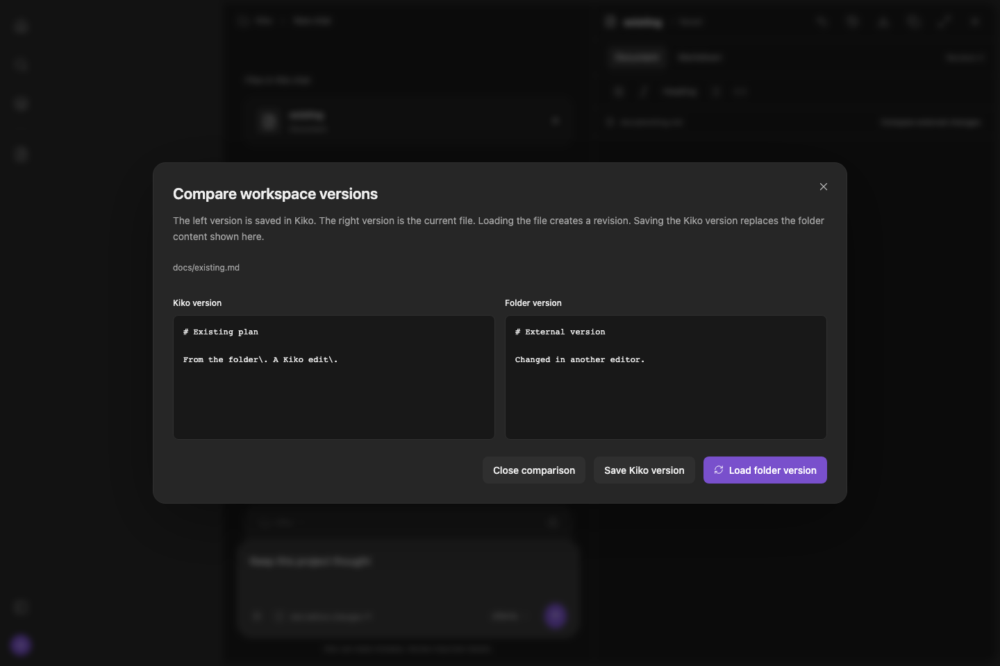

<div align="center">



### The documents agent. Say what you need, watch it get written, keep editing it yourself.


[What it makes](#what-kiko-makes) &nbsp;|&nbsp; [Who it is for](#who-kiko-is-for) &nbsp;|&nbsp; [How it works](#how-it-works) &nbsp;|&nbsp; [Run it](#run-locally) &nbsp;|&nbsp; [Contribute](#build-with-us)

</div>

<br>

Most AI tools hand you a wall of chat text and leave the formatting to you. **Kiko hands you the file.** Ask for a report, a lesson plan, a budget, or a slide deck, and the real document opens beside the chat, filling in section by section while you watch. It stays live: type into it, ask Kiko to change one paragraph, roll back to an earlier version, then export it to Word, PDF, Excel, PowerPoint, or Markdown.

Kiko is free and open source. You bring your own Meta Muse API key, pay Meta only for what you use, and your documents stay on your machine. You pick the Muse model for each chat. The default is **Muse Spark 1.3 Contributor** (`muse-spark-1.3-contributor`), which has discounted usage; Meta may use content sent to Contributor models to train its models, and Standard models do not.



<sub>Development preview with disposable sample data and the provider disconnected.</sub>

<br>

## What Kiko makes

One conversation can produce any of these, and each one is a real editor rather than a chat bubble.

| | Artifact | What is inside | Export |
| --- | --- | --- | --- |
| **DOC** | **Documents** | Headings, nested lists, task lists, tables, code blocks, links, and inline diagrams. Rich-text editing plus a Markdown view. | Markdown, DOCX, PDF |
| **XLS** | **Sheets** | Up to 20 named tabs, values and formulas, bold, fills, and number formats. Results calculate after each save. | XLSX, CSV |
| **PPT** | **Slide decks** | Up to 100 slides with title, bullets, columns, image, and chart layouts, plus speaker notes and image attachments. | PPTX, PDF |
| **SVG** | **Diagrams** | Sketch flowcharts, structures, and timelines on an Excalidraw board inside the document. The drawing stays editable and is captioned inline. | Inline in PDF, DOCX, Markdown |
| **TXT** | **Project files** | Any text file in a folder you choose: Markdown notes, code, configs, drafts. Edited beside the chat. | In place on disk |

**Bring in what you already have.** Attach PDFs, Word, PowerPoint, Excel, CSV, plain text, or PNG/JPEG/WebP images. Kiko extracts and indexes the text locally, and the agent can search and read it. Open existing Markdown, sheet, and deck files as editable artifacts without rewriting the originals.

**Look things up.** Add an optional Tavily key and Kiko searches and reads web pages before it writes a fact, within a limit of five research calls per turn.

<br>

## Who Kiko is for

Anyone who turns information into documents. You do not pick a template. You describe the result, and Kiko builds it.

| You are a | Ask Kiko for | You end up with |
| --- | --- | --- |
| **Student** | *"Turn this lecture PDF into a study guide, then a 10-slide revision deck."* | A study guide, a deck, a sourced report, or a proposal, exported as PDF or DOCX to hand in. |
| **Teacher** | *"Write a week-long unit plan on fractions with a marking rubric and a gradebook."* | Lesson plans, rubrics, worksheets, class slides, and a gradebook sheet with working formulas. Import last year's DOCX and revise it. |
| **Writer** | *"Outline my essay collection, then draft chapter two in my voice."* | A structured manuscript, with every chapter saved as Markdown in your project folder. Reshape one paragraph without touching the rest. |
| **Researcher** | *"Attach these six papers and draft a literature review comparing their methods."* | Summaries drawn from your own PDFs, a findings table, a data sheet with formulas, and a diagram of the method, all in one place. |
| **Developer** | *"Read this repo's `docs/` folder and write an architecture decision record for the queue change."* | Specs, ADRs, READMEs, and runbooks written straight into your project folder as Markdown, with diagrams. Runs against local Ollama if you want nothing to leave your machine. |
| **Founder or freelancer** | *"Write a client proposal, a budget, and a pitch deck for the creator platform."* | A proposal, a costed budget sheet, and a deck, ready to send as PDF, XLSX, and PPTX. |

<br>

## How it works



1. **Plan.** Kiko writes a skeleton first, with a placeholder block for every section, so you see the shape before the prose.
2. **Write.** Each section fills in as its tool call finishes. Every step (searching, reading, writing) is listed in the chat, so you never guess what it did.
3. **Ask.** Where it needs a fact only you know, Kiko pins a question on the exact passage with tap-to-answer replies. Facts it cannot verify are marked `[NEEDS: ...]` rather than invented.
4. **Shape.** Type directly into the document, or say *"make the budget section punchier."* The agent edits only what you asked. If you have unsaved changes, its edit cannot silently overwrite them.
5. **Keep.** Every change is a revision. Restore an older one at any time; the newer ones stay in history.

<br>

## Designed to be trusted with your work

| Control | What it means |
| --- | --- |
| **Surgical edits** | The agent replaces, inserts, deletes, or moves specific blocks, each checked against the current revision and a content hash. Stale or ambiguous edits are refused, not guessed. |
| **Stop is safe** | Stop cancels the request and keeps everything already written. |
| **No lost typing** | Edits save a local draft instantly and commit after a short pause. A failed save keeps your text and offers retry, copy, or discard. |
| **Folder sandbox** | Choose a folder and chats can read and write text files inside it, and nowhere else. Existing files need their current hash, and deleting a file always pauses for your approval. |
| **External changes** | Edit a file in another app and Kiko shows a side-by-side comparison, then lets you pick which version wins. It never merges silently. |
| **Keys stay put** | Keys live in your operating system keychain. They are never sent back to the interface. |
| **Local first** | Chats, documents, attachments, and drafts live in SQLite on your machine. No account, no sync, no telemetry. |

<div align="center">

| Edit a text file beside the chat | Compare changes made outside Kiko |
| :---: | :---: |
|  |  |

</div>

<br>

## Muse models

Kiko works with **Meta Muse** only for now. Add your API key once during setup, then choose a model for each chat from the composer. A new chat starts on the model you used last. Settings manages the API key and nothing else, and Kiko never switches models on its own after an error.

| Model | Id | Mode | Best for |
| --- | --- | --- | --- |
| **Muse Spark 1.3** | `muse-spark-1.3-contributor` | Contributor | Default. The latest Spark at a lower price. |
| **Muse Spark 1.3** | `muse-spark-1.3` | Standard | The latest Spark, with no training on your content. |
| **Muse Spark 1.2** | `muse-spark-1.2-contributor` | Contributor | The previous Spark at a lower price. |
| **Muse Spark 1.2** | `muse-spark-1.2` | Standard | The previous Spark, with no training on your content. |
| **Muse Ember** | `muse-ember-1.0` | Standard | Fast, low-cost, high-volume work. |
| **Muse Wonder** (preview) | `muse-wonder-1.0` | Standard | Long, complex agent work. |

Contributor models let Meta use submitted content and responses for training in exchange for a lower price. Connecting sends one short readiness request that may use a few credits, and sending a message shares the conversation and tool results with Meta. Which models your account can use depends on your Meta team's access; an unavailable model is reported when you send.

<br>

## Current state

> [!NOTE]
> **Development build.** The core workflow and the later-release features are implemented: documents, sheets, decks, diagrams, attachments, research, folder workspaces, per-chat Muse model choice, and a personal self-hosted web mode. Local automated checks pass. Still pending: live Muse quality checks, full accessibility and native review, how exports look in Word, PowerPoint, and LibreOffice, and Windows and Linux runtime checks. See the [build checklist](docs/steps.txt) and [feature scope and limits](docs/later-releases.md).

<details>
<summary><b>Known limits worth knowing</b></summary>

<br>

- Sheets: A1:CV1000, 10,000 populated cells, bounded formula function set. Raw text files have no revision-history browser yet.
- Decks: PPTX charts are editable shapes, not native Excel chart objects. Imported Office media and fonts are not reused.
- Office previews show extracted text, not the original layout.
- Attachments: 20 MB each, 512 MB stored in total.
- Folder files: UTF-8 text up to 1 MB, 500 entries per directory listing.
- Web mode is a personal, single-owner workspace, not a multi-user service.

</details>

<br>

## Run locally

You need **Go 1.27+**, **Node 24.15+ or 26+** (Node 22.22.2+ also meets the dependency requirements), npm, and **Wails v2.17.0**. Use Wails v2; this repository does not target v3.

```sh
go install github.com/wailsapp/wails/v2/cmd/wails@v2.17.0
wails doctor
npm --prefix frontend ci
npm --prefix frontend run build
wails dev
```

Make sure the Go binary directory is on your PATH. Install the native prerequisites for your platform before running the doctor:

| Platform | Native prerequisites | Validation here |
| --- | --- | --- |
| macOS | Xcode command line tools | Apple Silicon build checked; current visual/launch review pending |
| Windows | WebView2 runtime and the Go C compiler toolchain required by Wails | Not yet checked |
| Linux | GCC, GTK3, WebKit2GTK development libraries; a Secret Service keyring for runtime key storage | Not yet checked |

Follow [Wails' platform setup instructions](https://v2.wails.io/docs/gettingstarted/installation/) for exact packages. Linux distributions using WebKit2GTK 4.1 require `-tags webkit2_41` on Wails commands.

To inspect only the frontend, run `npm --prefix frontend run dev -- --host 127.0.0.1`. This URL has no Go bridge. For a working browser preview, keep `wails dev` running and open its application-server URL (normally http://localhost:34115).

**Prefer a browser?** Kiko can also serve itself as a personal self-hosted web workspace with an encrypted server-side key vault. See [web mode](docs/web.md).

<details>
<summary><b>Check and build</b></summary>

<br>

```sh
npm --prefix frontend ci
node scripts/check.mjs
wails build
node scripts/setup-runtime.mjs
```

The local runner checks formatting, lint, frontend tests, strict TypeScript, the production frontend build, Go formatting, `go vet`, and Go tests with the race detector. Fix frontend formatting with `npm --prefix frontend run format` and Go formatting with `gofmt`. A fresh checkout must build the frontend before a plain `go test ./...` because Go embeds `frontend/dist`.

Run `node scripts/setup-runtime.mjs` after packaging to bundle the checksum-verified Typst 0.15.1 compiler, its notices, and the project license files. PDF and diagram rendering need this runtime or `KIKO_TYPST_BINARY`. On macOS the script re-signs the updated bundle locally. See [quality checks](docs/quality.md) for focused commands.

</details>

<details>
<summary><b>Where things live</b></summary>

<br>

```text
main.go, app.go    Wails lifecycle and thin desktop bindings
keys.go            OS keychain adapter
core/              Storage, streaming, agent tools, documents, sheets, decks, exports, settings
frontend/src/      React interface and interaction tests
docs/              Product, design, protocol fixtures, and ordered build steps
build/             Native packaging resources; build/bin is generated
```

</details>

<br>

## Your data and your key

Desktop Kiko stores content, attachment bytes, and drafts in SQLite, and keeps the Muse and Tavily keys in separate OS-keychain accounts. A missing key prompts reconnection without deleting anything, and saved conversations stay readable without one. Stored keys are never returned to the frontend. Optional Tavily calls share queries and URLs with Tavily. Stop cancels the local request without guaranteeing immediate provider-side cancellation. See [storage](docs/storage.md) for the data location and the `KIKO_DATA_DIR` development override. Removing a chat, a project, or resetting Kiko never deletes files in your chosen folders.

<br>

## Learn more

| Product | Engineering | Community |
| --- | --- | --- |
| [The pitch](docs/kiko-pitch.md) | [Technical spec](docs/kiko-spec.md) | [Contributing](CONTRIBUTING.md) |
| [Design system](docs/design-system.md) | [Muse API contract](docs/muse-api-contract.md) | [Security](SECURITY.md) |
| [Editable documents](docs/documents.md) | [Folder workspaces](docs/folder-workspaces.md) | [GPL-3.0-only](LICENSE) |

<br>

## Build with us

There is room for Go, React, accessibility, design, testing, and documentation work. Start with [CONTRIBUTING.md](CONTRIBUTING.md), read [agents.md](agents.md), and take a focused item from [steps.txt](docs/steps.txt). Keep unfinished work unchecked and include evidence when completing a step.

Kiko's source is licensed under **GNU GPL version 3 only**, SPDX `GPL-3.0-only`. See [LICENSE](LICENSE) and [third-party notices](THIRD_PARTY_NOTICES.md). Dependencies keep their respective licenses.

<div align="center">

<sub>**Kiko** &nbsp;·&nbsp; every idea deserves a plan</sub>

</div>
