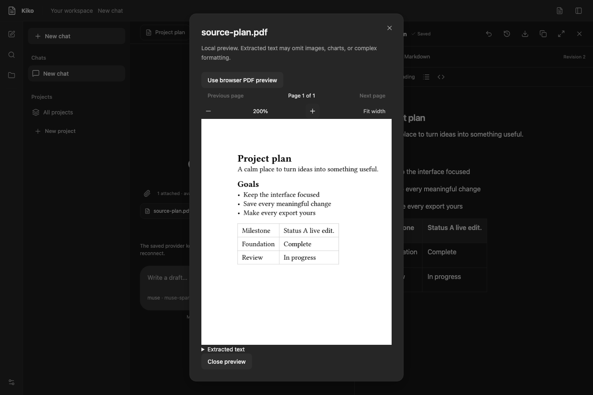

# Quality checks

## Local command

Install the toolchain and native prerequisites from the README, then run from the repository root:

```sh
npm --prefix frontend ci
node scripts/check.mjs
```

The runner stops on the first failed check and returns a nonzero exit code. It checks frontend formatting, Oxlint rules, frontend tests, strict TypeScript compilation, and the production Vite build. It then checks Go formatting, runs `go vet`, and runs the Go tests with the race detector and a five-minute test timeout. Go module changes are disallowed during checks. Build the frontend first because Go embeds its output; the runner handles this ordering.

Formatting checks include frontend source/configuration, the local check script, and CI workflow YAML. Generated bindings, node_modules, and build outputs are outside that scope. Go formatting uses the source files in the current module's packages, including tests, rather than traversing dependency directories.

Fix frontend formatting with `npm --prefix frontend run format`. Fix Go formatting with `gofmt -w` on the files listed in the failure. `.editorconfig` and `.gitattributes` keep indentation and line endings consistent across platforms. TypeScript strict mode applies to application and build configuration code.

For a focused change, use `npm --prefix frontend test`, `npm --prefix frontend run lint`, `npm --prefix frontend run typecheck`, or a targeted Go test. Run the complete check command before submitting a change. None of these tests requires a real provider key.

## Continuous integration

`.github/workflows/ci.yml` runs the same local checks and a native Wails build on:

| Runner | Native setup |
| --- | --- |
| `macos-15` | Hosted Xcode/command line toolchain |
| `windows-2025` | Hosted GCC toolchain, checked before compilation; WebView2 is required for an interactive launch |
| `ubuntu-24.04` | `build-essential`, `pkg-config`, `libgtk-3-dev`, `libwebkit2gtk-4.1-dev`; `webkit2_41` build tag |

The workflow uses the Node version in `.nvmrc`, the Go toolchain declared in `go.mod`, and Wails CLI 2.17.0. Third-party actions are pinned to the verified official release commits, with versions beside them. It runs on pushes, pull requests, and manual dispatch with read-only repository access and no persisted checkout credentials. It does not publish artifacts, invoke Muse, use signing keys, or require repository secrets.

The matrix is a configuration ready for hosted execution. Local macOS results do not count as successful Windows or Linux runs. This checkout has no configured remote; record actual hosted results once the repository is connected. Workflow syntax can be checked independently with:

```sh
go run github.com/rhysd/actionlint/cmd/actionlint@v1.7.12 .github/workflows/ci.yml
```

Actionlint is an optional development validator, not an application dependency. It checks workflow configuration; it does not execute the jobs. Consult the [official workflow syntax](https://docs.github.com/en/actions/reference/workflows-and-actions/workflow-syntax) and [Wails platform prerequisites](https://v2.wails.io/docs/gettingstarted/installation/) when changing the matrix.

## Desktop smoke check

The CI native build is the automated packaging smoke check. Frontend tests exercise startup, onboarding, navigation, keyboard dialogs, themes, and failure states through a mock binding. Go tests exercise real temporary databases, onboarding coordination, and a local HTTP readiness server; the keychain adapter uses a mock backend. A manual native launch closes the gap between those two layers:

1. Run the local quality checks and `wails build`. On Linux, set the `webkit2_41` tag for both Go checks and the native build.
2. For isolated testing, set `KIKO_DATA_DIR` to a new temporary directory and launch the native executable with that environment. Normal launches use the user's configuration folder. The override does not change the OS keychain namespace; do not inject dummy entries into a real keychain.
3. On fresh data, confirm nickname onboarding appears after initialization. Enter a disposable nickname and continue to Muse setup. Without a real key, stop here; no inference or secure-save success is implied. With an explicitly supplied key, Connect may use provider credits and should lead to Home on success.
4. Resize the window, confirm controls stay visible, then close and relaunch. Incomplete setup should resume at Muse with the nickname preserved; completed setup should open the workspace. Use the automated fake-service tests for authenticated workspace behavior when credentials are unavailable. Capture failures without private environment values.
5. Record the platform/toolchain, build result, observed bridge response, and any limitation in `docs/development.md`.

Repeat this launch check when the desktop binding, window configuration, or asset-loading behavior changes. New features must extend their own tests and the relevant smoke scenarios. Current storage/onboarding/navigation tests do not establish live generation or document editing; those start in Phase C/D. Keep live provider checks separate and explicitly initiated.

## Packaged offline smoke check

After building and bundling the pinned runtime, run:

```sh
node scripts/package-smoke.mjs build/bin/Kiko.app/Contents/MacOS/Kiko
```

Use the built executable path on Windows/Linux. This starts `--web` on an ephemeral loopback port with generated synthetic login/vault secrets and a disposable data directory. It checks unauthenticated refusal, login/RPC, sheet calculation/XLSX, document DOCX/PDF, PDF worker import, slide PDF plus the slide PPTX editor contract, and logout, then stops the process and deletes only that test directory. It never connects a real provider, touches the desktop keychain, or resets normal user data. Format internals and compiler page counts have separate Go tests; this smoke command does not certify native save dialogs or Office appearance.

## Browser evidence — November 9, 2026

A supplemental headless Chromium pass used the real packaged HTTP server with temporary sample data and synthetic session/vault secrets. It covered login and nickname screens, desktop workspace, rich document/table rendering and saved typing, sheet formula editing/flushing, slide editing, Settings, and document/deck layouts at 390×844. No uncaught page errors or outer horizontal overflow were observed. Inspection waited for dialog animations and closed mobile navigation to review the actual editor. The pass exposed an initialization-only table revision, now covered by a regression test. It does not certify real phone interaction, screen readers, native save dialogs, or full keyboard navigation. The native computer-use hosts remained unavailable.

## PDF page images and direct model input

Tests render a two-page graphics fixture through the actual embedded PDFium engine and check page colors, dimensions, aspect ratio, invalid inputs, cancellation, and transparent pages composed onto paper white. Provider fixtures verify OpenAI content parts and Anthropic base64 blocks, refusal by the Muse text adapter, and non-mutation of input history. Agent tests cover exact-model opt-in, source ownership, multi-tool ordering, transient image handling, and disabling direct tools after a model change. Frontend tests exercise opt-in, local page navigation/failure, and recovery from a failed lazy browser PDF module. The packaged smoke test now calls RenderAttachmentPage and checks an actual PNG prefix from the child worker. No live inference is performed by these checks.

The actual PDFium JIT render fixtures run in a separate non-race Go test invocation in the quality runner: race instrumentation makes third-party WASM JIT compilation disproportionately expensive. The main race suite still checks worker cancellation, source ownership, provider transports, and the agent loop; it explicitly skips only the actual JIT render/malformed-document integrations. Packaged smoke exercises the release-compiled renderer child as well.

Follow-up browser verification exercised the packaged renderer through a real PDF attachment, switched from browser preview to local page images, checked decoded PNG display, and inspected zoomed output. Desktop and 390px document/deck passes continued without uncaught page errors. This uses disposable sample data and does not certify live model vision or original Office rendering.

Model tests cover the catalog, per-chat model choice, new chats inheriting the last choice, rejection of unlisted ids, and the migration that retires other providers.



The visual budget test submits seven helper inspections to a synthetic local endpoint and verifies exactly six helper requests, a saved refusal for the seventh, and a visible limit response for the main model. Direct images and helper calls share this per-turn cap.

## Workspace completion checks — November 9

The frontend suite now includes folder expansion/open/error states, explicit source comparisons and stale-version failures, and text draft recovery/guarded navigation saves. Core tests cover all three custom source formats, path collisions and escapes, existing-file imports, project-Home draft preservation, external reload guards/history, explicit disk-version replacement, and direct writes across artifact import. Source paths survive failed writes.

Supplemental packaged-browser checks used temporary folders and synthetic server credentials. They exercised real directory browsing, text saves, importing Markdown without rewriting the original, project-Home draft preservation, editor-to-source saves, external comparisons/reload/history, explicit conflict resolution, custom document/sheet/deck paths, recovered text drafts after reload, and narrow layouts. Native save/open and screen-reader/platform certification remain separate checks. No paid requests were made.
